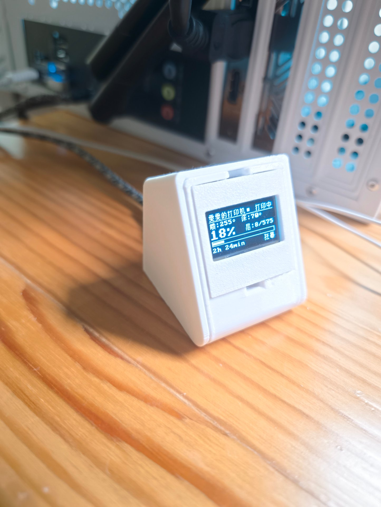

# 竹报 esp32-bambu_bao

> 竹报平安 —— 一块小屏，向你「报」拓竹打印机的平安。

**竹报**是一台基于 ESP32-C3 + 0.96 寸 OLED（SSD1306/SH1106，128×64）的拓竹（Bambu Lab）打印状态显示器。设备通过 WiFi 连接拓竹云 MQTT，独立运行、实时刷新，不需要电脑常驻：



屏幕内容从上到下：设备名 + 在线指示 / 打印状态、喷嘴/热床温度、大号百分比 + 层数、进度条、剩余时间 + 速度档（狂暴/运动/标准/静音）。

## 功能

- **两阶段配置流程**（配网与登录分离，每一步只用一种网络模式，稳定可预期）：
  - **第 1 步 · AP 配网**：首次开机（或长按 BOOT 3 秒）设备开出热点 `A1MON-XXXX`，手机连上后打开 `http://192.168.4.1`，只填 WiFi 名称/密码，保存后设备重启。此阶段不访问拓竹云。
  - **第 2 步 · 账号登录**：设备连上路由器后，屏幕显示设备 IP。手机连**同一个路由器**，浏览器打开该 IP，填手机号 → 获取短信验证码 → 填码登录 → 保存重启，进入监控界面。
- **实时监控屏**：打印状态、喷嘴/热床温度、进度百分比、层数、剩余时间、速度档、错误码（反白高亮）。
- **自愈能力**：MQTT 断线自动重连；token 失效自动回到登录页提示重新登录；90 秒无数据自动重启 MQTT。
- **中文界面 + 按需字库**：汉字点阵由脚本从界面文案自动生成（当前约 86 字，仅 2.4 KB），改文案不会出现字库缺字；运行时设备名等新字符可通过 `EXTRA_CHARS` 补充。
- **一个账号可配多台设备**，每台 ESP 独立登录、独立订阅。
- 支持 A1 / A1 mini（`gcode_state=RUNNING`）、P1 / X1 系列（`PRINTING`）等机型字段。

## 硬件

| 物料 | 说明 |
|---|---|
| ESP32-C3 迷你开发板 | 超级迷你（SuperMini）/ XIAO 尺寸均可，需引出 GPIO3/GPIO4 与 BOOT 键 |
| 0.96 寸 OLED | 128×64，I2C 接口，SSD1306 或 SH1106 主控（4 针：VCC/GND/SCL/SDA） |
| USB 数据线 | 烧录时连电脑；日常使用任意 5V USB 电源即可 |
| 3D 打印外壳 | 可选，人字斜面造型，屏幕仰角朝向桌面使用者（见上方实拍） |

### 接线

| OLED 引脚 | ESP32-C3 |
|-----------|----------|
| VCC       | 3.3V     |
| GND       | GND      |
| SCL       | GPIO4    |
| SDA       | GPIO3    |

> 引脚与屏幕主控在 `main/app_main.c` 顶部宏处修改（`OLED_SDA_GPIO`、`OLED_SCL_GPIO`、
> `OLED_SH1106`）。若屏幕整体偏移 2 列或出现边缘竖线，通常是 SH1106，把 `OLED_SH1106` 改为 `1`。

## 外壳 3D 模型

人字斜面造型，屏幕仰角朝向桌面使用者（见上方实拍图）：

- 中国大陆地区：[MakerWorld 中国大陆模型页](https://makerworld.com.cn/models/1864921)

## 目录结构

```text
main/                  ESP-IDF v6.1 固件源码
  app_main.c           启动流程、云端监督任务、BOOT 按键
  app_state.[ch]       共享状态（互斥锁保护）
  app_config.[ch]      NVS 配置读写
  display/             OLED 驱动、字库、各屏绘制
  net/                 WiFi / 配网门户 / 拓竹云 API / MQTT
scripts/               构建烧录与工具脚本（见下文）
docs/images/           成品照片
```

## 安装与使用

### 1. 烧录固件

安装 [ESP-IDF v6.1](https://docs.espressif.com/projects/esp-idf/zh_CN/v6.1/esp32c3/get-started/index.html) 后：

```bat
cd zhubao
scripts\build.bat          rem 编译
scripts\flash.bat COM5     rem 烧录（替换成实际 COM 口）
```

> `scripts\erase.bat` 可清空 NVS（WiFi + 拓竹凭据），让设备回到出厂状态。
> 普通 `flash.bat` 不动 NVS，重复烧录会沿用已保存的配置。

### 2. 首次配网（第 1 步）

1. 烧录后设备自动进入配网模式，屏幕显示热点名与地址。
2. 手机连接热点 `A1MON-XXXX`（无密码），浏览器打开 `http://192.168.4.1`。
3. 选择 WiFi（支持扫描）、输入密码，点「保存并重启设备」。

### 3. 登录拓竹账号（第 2 步）

4. 设备重启联网后，屏幕显示「拓竹账号登录」和设备 IP（如 `192.168.5.246`）。
5. 手机连**同一个路由器**，浏览器打开该 IP。
6. 填拓竹 App 注册的手机号 → 点「获取验证码」→ 填短信验证码 → 「登录」。
7. 登录成功后点「保存并重启设备」，屏幕进入监控界面。拔掉电脑，换任意 USB 电源供电即可。

### 日常使用

- 上电即用：设备自动连 WiFi → 缓存 token 自动登录 → 连接云 MQTT → 显示状态。
- **重新配网**：长按 BOOT 键（GPIO9）3 秒，回到第 1 步。
- 打印机离线时设备保持重连；打印机开机后约 5 秒内恢复显示。

## 屏幕状态一览

| 屏幕 | 含义 |
|---|---|
| `配网设置` + `热点:A1MON-XXXX` + `192.168.4.1` | 第 1 步：连热点填 WiFi |
| `拓竹账号登录` + IP（闪烁） | 第 2 步：用同网段手机打开该 IP 登录 |
| `WiFi / 正在连接`、`云端 / 正在登录`、`MQTT / 正在连接` | 启动过程中的各阶段 |
| 监控主屏（五段布局） | 正常运行，实时显示打印状态 |
| `! 登录失败 !` / `错误 XXXXXXXX` | 登录失败回配网 / 打印机报错码 |

## AI 辅助安装指南

本项目结构清晰、脚本齐全，**非常适合让 AI 编程助手（WorkBuddy / Claude Code / Cursor 等）代你完成安装与排障**。给 AI 的推荐提示词：

### 让 AI 完成环境与烧录

```text
我的电脑是 Windows，请帮我从零完成 zhubao 项目的构建与烧录：
1. 检查/安装 ESP-IDF v6.1 工具链；
2. 用项目里的 scripts\build.bat 编译；
3. 检测我的 COM 口号并用 scripts\flash.bat 烧录；
4. 烧录后用 scripts\sniff.py 抓串口日志，确认设备进入配网模式。
每一步失败时先读日志定位原因再重试，不要盲目重复执行。
```

### 让 AI 排查运行问题

设备的实时日志可以**不重启设备**直接抓取（对排障极其友好）：

```bat
python scripts\sniff.py COM3
```

把日志发给 AI，并附上这段提示词：

```text
这是 zhubao 的串口日志。请对照 README 的「数据与协议」「常见问题」章节，
判断问题出在哪一层（WiFi / TLS / 云端登录 / 设备列表 / MQTT），
给出最小修改方案。注意：-0x2700 是证书验签失败，ESP_ERR_HTTP_CONNECT 是连不上，
两者原因完全不同；418 是云端风控（按出口 IP 计），不要重试。
```

### 让 AI 改造界面

```text
请帮我调整 ui.c 的监控屏布局：<你的需求>。
要求：改完运行 scripts\preview_ui.py 检查无溢出/重叠；
若新增了汉字，运行 scripts\gen_cjk_font.py 重新生成字库；
然后 build.bat + flash.bat COM3 烧录验证。
```

> 给 AI 维护者的提示：`main/display/font_cjk.h` 与 `main/net/cloud_roots.h` 是生成物，
> 勿手改；改中文文案必须重跑 `gen_cjk_font.py`，改布局必跑 `preview_ui.py`。

## 数据与协议（简述）

- 登录：拓竹云 `POST /v1/user-service/user/sendsmscode`（发码）+ `POST /v1/user-service/user/login`（验证码换 `accessToken`），请求带 slicer 指纹头（`bambu_network_agent` UA + `X-BBL-*`，与 PrintSphere 一致）。
- 设备列表：`GET /v1/iot-service/api/user/bind`（Bearer）。
- 云 MQTT：`{cn|us}.mqtt.bambulab.com:8883`（TLS），用户名 `u_{uid}`，密码 = accessToken，订阅 `device/{序列号}/report`，每 5 秒 pushall。
- 解析字段：`gcode_state / percent / nozzle_temper / bed_temper / mc_remaining_time / layer_num / total_layer_num / spd_lvl / print_error / ams(tray_type)`。
- TLS 按域名钉根：`api.bambulab.cn` → GlobalSign R3；`api.bambulab.com` 与 `*.mqtt.bambulab.com` → DigiCert Global Root G2（详见源码注释与踩坑记录）。

## 常见问题（FAQ）

- **提示「云端风控拦截」**：拓竹云对登录接口按**出口 IP** 计风控，同一路由器下所有设备都会被拦。标记会自行过期（数分钟），等待即可；连点重试只会延长。设备侧已有 120 秒冷却保护。
- **提示「该账号只能用短信验证码登录」**：账号在拓竹侧被设为 `verifyCode`，验证码登录是唯一路径；可在拓竹 App 里改设密码（历史版本固件支持密码登录与自动续期）。
- **屏幕出现空心方框（口口）**：某个汉字不在字库里。若是运行时数据（如改了打印机名），把新字加进 `scripts/gen_cjk_font.py` 的 `EXTRA_CHARS` 后重跑。
- **验证码「现收现填也报过期」**：确认没有把全角数字（１２３）混入；设备已做归一化，但旧固件需升级。
- **MQTT 卡在「正在连接」**：串口若报 `mbedtls_ssl_handshake returned -0x2700`，是证书根不匹配——确认 `bambu_mqtt.c` 钉的是 DigiCert Global Root G2。

## 致谢

- [printsphere-lite](https://github.com/ccord34/printsphere-lite) —— 拓竹云协议的参考实现（slicer 指纹头、登录状态机、设备端分工），本项目登录与 TLS 方案大量对齐该项目及其上游 PrintSphere 固件。
- [OpenBambuAPI](https://github.com/Doridian/OpenBambuAPI) —— 云 MQTT 报文字段文档。
- [font8x8](https://github.com/dhepper/font8x8) —— 公共领域 ASCII 点阵。

## License

供个人学习与非商业使用。商用、量产、付费集成需另行授权。
